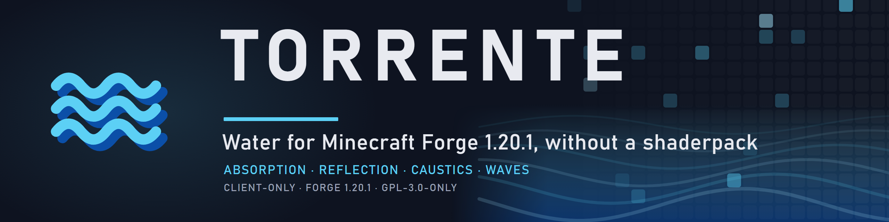
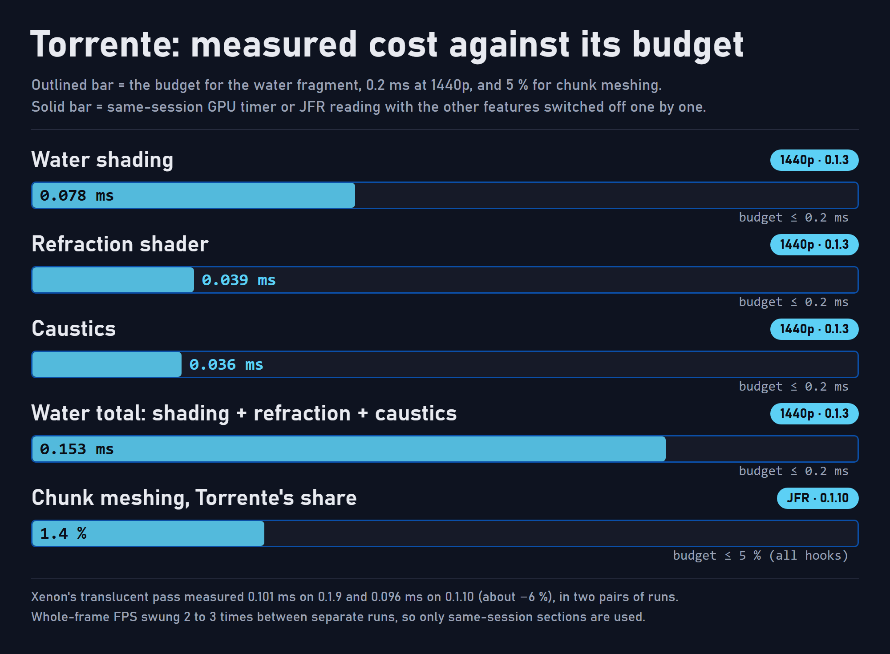

<p align="center">
  
</p>

# Torrente

Torrente is the water mod of the [Atmosphera](https://github.com/SolarBiscuit/Atmosphera) suite for Minecraft 1.20.1 on Forge. It gives water depth colour, reflections, glints, refraction, foam, waves and caustics **without a shaderpack**: the work is done in the terrain shaders the game already runs, with no second geometry pass.

> **Client-only.** Torrente is never required on a server and never blocks joining one. It needs [AtmospheraLib](https://github.com/SolarBiscuit/AtmospheraLib), and it steps aside when a shaderpack replaces the terrain shaders.

## Features

This is the feature set Torrente will have when its [roadmap](#roadmap) is complete. Items marked † are research items: each ends in a written go/no-go and ships only if it passes.

### Colour and depth

- **Water styles.** Unbound, Glimmer, Reimagined, Vanilla+ and a fully editable Custom style. Styles are JSON files, so a resource pack can replace or add them.
- **Depth absorption.** Per-channel Beer-Lambert absorption over the real view thickness, from the scene depth. Shallow water is clear and deep water takes its colour.
- **Underwater fog** in the style's colour, with the visibility set by the style.
- **Exact depth for every effect.** Depth comes from the world's own water column instead of a skylight guess, so lit caves and the water under overhangs behave correctly.
- **Entities under water.** Mobs, items and block entities below the surface take the same absorption as terrain.

### Surface

- **Reflections.** Fresnel reflection of the sky, plus planar reflections of the terrain, trees and buildings on the water's most common plane, with the sky as the fallback where it cannot reach.
- **Sun and moon glints,** shaded by the sun's real visibility, and **crest glow**: light seen through the tops of the swell when looking toward a low sun.
- **Refraction** of the scene behind the water, with Snell's window when looking up from below, and glass or ice behind refracting water kept visible†.
- **Turbid refraction†.** Deeper water blurs what lies behind it.
- **Shore foam** that fades in and out with the water's vertical depth.
- **Waterline.** When the camera is half in the water, the line where the surface cuts the screen is drawn analytically.

### Motion

- **Waves that follow the wind.** A vertical vertex swell and detail ripples, with the dominant swell lined up with the wind from Gale and the lib's shared wind. Wave directions never turn, so a veering wind never makes the pattern jump.
- **Rain rings** on water open to the sky, while it rains.
- **Interactive ripples.** Entities and boats push a wave-equation ripple field around the camera.
- **No hourly pop.** Every animation completes a whole number of cycles per clock wrap.

### Caustics

- **Caustics along the sun.** The pattern is looked up where the refracted sun ray meets the surface, so it moves with the sun and lines up with shadows. Walls show a proper slice of it, and faces are lit by their angle to the ray.
- **Dispersion** on HIGH: red and blue focus a little apart, for coloured edges in shallow water.
- **Underwater shafts.** With Lumis, sun beams under water use the style's density and absorption colour, modulated by the caustics.

### Compatibility

- **Same surface on LODs.** NeoVoxy LOD water uses the same normals, so the hand-over from near water to LOD water is seamless.
- **Shaderpack aware.** When a shaderpack replaces the terrain programs, Torrente turns the affected features off and logs why.
- **Quality levels** with live options, so most changes need no restart.

## Performance

Torrente is built to a budget: **at most 0.2 ms of GPU time for the water fragment at 1440p**, inside the suite's 0.6 ms total, and at most 5 % of chunk meshing for all Atmosphera hooks together.

<p align="center">
  
</p>

The figures below are the project's own measurements, taken with the in-repo scenes and tools on the RatPack 2.9 test client, an RX 7900 XTX, at 2560x1440. **Only AMD hardware has been tested.** Anything that may behave differently on NVIDIA or Intel is unverified.

| Metric | Result |
|---|---|
| **Frame rate** | Whole-frame FPS swung two to three times between separate runs (one Torrente run read 212 fps, the next 553, the baseline 413), so no frame-rate claim is made. Costs are same-session GPU readings. |
| **GPU**, all water features on (0.1.3) | about 0.22 ms in total: shading 0.078, refraction 0.039, caustics 0.036, scene depth copy 0.020 (AtmospheraLib), colour copy 0.045 |
| **GPU**, Xenon's translucent pass | 0.101 ms (0.1.9) → 0.096 ms (0.1.10), about −6 %, in two pairs of runs |
| **GPU**, waves | about 0 (vertex-only) |
| **Sync** | no OpenGL calls of its own; the scene copies and GL state handling belong to AtmospheraLib (3.1 queries per frame on average with all features on and RADIAL shafts, 8 with AUTO) |
| **CPU**, chunk meshing | 1.4 % of meshing samples (1.1 % on 0.1.9), measured with Gale and the lib; all Atmosphera hooks together 1.8 % against the 5 % budget |
| **CPU**, per frame | the custom style is rebuilt only when an option changes (it was rebuilt every frame before 0.1.10) |

## Roadmap

| Release | Theme | Content |
|---|---|---|
| 0.1.x | Foundation | Styles, absorption, Fresnel and glints, refraction, foam, swell and ripples, caustics, underwater fog; whole-cycle animation and cheaper ripples |
| 0.2.x | Light (**current: 0.2.1**) | Wind-aligned waves, sun-projected caustics, crest glow, rain rings, caustic dispersion, exact caustic depth from the column field |
| 0.3.0 | Mirror | Planar reflections (compute, one plane, sky fallback) |
| 0.4.0 | Contact | Interactive ripples, underwater shafts with Lumis, entities under water, waterline; research: glass behind water, turbid refraction |

Dates are not promised. Each feature release is a minor version (0.X.0). Version 1.0.0 is only used when the project is declared complete.

## Requirements

- Minecraft **1.20.1** with Forge **47.x**
- Java **17** or newer
- [AtmospheraLib](https://github.com/SolarBiscuit/AtmospheraLib) **0.5.0** or newer
- An Embeddium-based terrain renderer (developed and tested with Xenon 0.3.31)
- Optional: Gale for wind-aligned waves, Lumis for underwater shafts, NeoVoxy for LOD water

## Installation

1. Install AtmospheraLib and an Embeddium-based terrain renderer.
2. Place `torrente-<version>-mc1.20.1-forge.jar` in `mods`.
3. Options are in the Atmosphera tab of Video Settings, and in `config/SolConfig/atmosphera/`.

## Building

```bash
./gradlew :Torrente:build
```

Torrente builds from the Atmosphera Gradle multi-project: the four repositories checked out side by side under one root that holds `settings.gradle`, `gradle.properties` and the wrapper. It needs a JDK 17 and writes `Torrente/build/libs/torrente-<version>-mc1.20.1-forge.jar`.

## Licence and attribution

- Torrente is licensed under the **GNU General Public License v3.0 only** ([`LICENSE`](LICENSE)). Copyright (C) 2026 SolarBiscuit.
- Additional terms under GPL-3.0 section 7 are in [`NOTICE`](NOTICE). Every copy or substantial portion that you distribute, original or modified, must keep that notice and credit "SolarBiscuit" with a link to <https://github.com/SolarBiscuit/Torrente>. A modified version must be clearly marked as modified, and must not be presented as the original work or under its name and author without that marking.
- **Third-party material.** Parts of the water shaders and styles are adapted from MIT-licensed work: the absorption and scattering coefficients of Glimmer Shaders v1.5.2 (Copyright (c) 2024 Josh Britain) and the wave-normal octave scheme of "Very fast procedural ocean" by afl_ext (2017). Their copyright and permission notices are kept in [`THIRD_PARTY_NOTICES.md`](THIRD_PARTY_NOTICES.md). MIT is compatible with GPL-3.0, so the combined work remains GPL-3.0-only, and the MIT notices stay with the material they cover. No Complementary Shaders code is used.
- The Torrente jar bundles no third-party libraries. It is built against Minecraft, Forge and AtmospheraLib, which are not redistributed with it.
- Torrente is an independent project. It is not affiliated with, endorsed by, or supported by Mojang Studios, Microsoft, Minecraft Forge, or the authors of Glimmer Shaders or any other shaderpack.

## Reporting issues

Issues belong in the [Torrente issue tracker](https://github.com/SolarBiscuit/Torrente/issues). Please include the Torrente and AtmospheraLib versions, your renderer and shaderpack (if any), your GPU and driver, and `latest.log`. The output of `/atmosphera status` helps.
